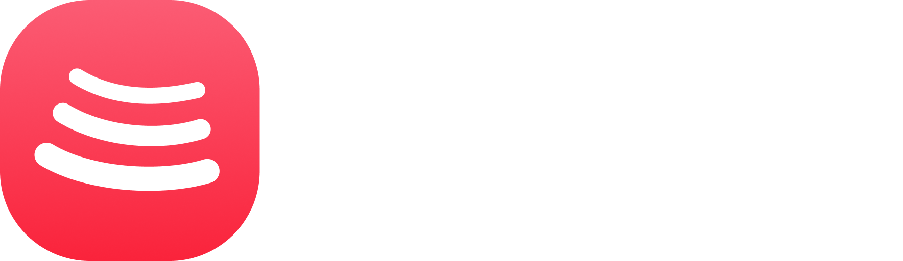

<div align="center">



# ForkChord

An Apple Music-inspired desktop player for YouTube Music, built on BitChord.

**Windows · macOS · Linux**

<p align="center">
  <a href="https://github.com/nxfu/ForkChord"></a>&nbsp;
  <a href="https://github.com/nxfu/ForkChord/releases"></a>&nbsp;
  <a href="LICENSE"></a>
</p>

<p align="center">
  <a href="https://github.com/nxfu/ForkChord/releases/latest"></a>&nbsp;&nbsp;
  <a href="https://github.com/nxfu/ForkChord/releases/latest"></a>
</p>

[Windows downloads](https://github.com/nxfu/ForkChord/releases/latest) · [Linux downloads](https://github.com/nxfu/ForkChord/releases/latest) · [macOS downloads](https://github.com/nxfu/ForkChord/releases/latest) · [All releases](https://github.com/nxfu/ForkChord/releases) · [Issues](https://github.com/nxfu/ForkChord/issues)

</div>

ForkChord is an independent community desktop fork of BitChord. It includes YouTube Music, local music, lossless sources, word-synced lyrics, crossfade, beat-matched Automix, downloads, and desktop media controls.


## What this is

This repository is the desktop port of [kushagrasinghx/BitChord](https://github.com/kushagrasinghx/BitChord). The architecture is deliberately simple:

```
┌────────────────────────────────────────────────────────────┐
│  app/            the web frontend, byte-for-byte identical │
│  (React + Vite)  to the deployed web player — the frosted  │
│                  glass UI, lyrics, AutoMix, queue, everything │
└───────────────▲────────────────────────────▲───────────────┘
                │ same-origin bridge         │ injected shim
                │ window.postMessage         │ (desktop.js)
┌───────────────┴────────────────────────────┴───────────────┐
│  src-tauri: the Rust shell                                 │
│                                                            │
│  core (bitchord-core)          shell                       │
│  ├─ yt: signed InnerTube       ├─ tray + close-to-tray     │
│  │   requests, account switch  ├─ media keys (SMTC/MPRIS/  │
│  ├─ spotify: library bridge    │   Now Playing via souvlaki)│
│  ├─ discord: rich presence     ├─ dynamic island (overlay) │
│  ├─ lyrics/addon: CORS-free    ├─ sign-in agent windows    │
│  │   fetches                   ├─ deep links bitchord://   │
│  └─ one JSON store             ├─ single instance          │
│                                └─ launch at login          │
└────────────────────────────────────────────────────────────┘
```

### Why the frontend is *exactly* the same

The web app talks to a browser extension over a typed postMessage bridge (`@bitchord/shared/bridge`). This build **is** the extension, implemented natively:

- The web app's own `detectExtension()` finds it (the injected `desktop.js` shim answers its `ping` on the relay transport — the same transport Firefox uses), so every feature the page gates on capabilities turns on, with **zero changes** to the frontend code.
- On the other side, the Rust core (`src-tauri/core`) serves the full bridge protocol — a faithful port of the extension's `ytAuth.ts`, `ytFetch.ts`, `spotify.ts`, `discord.ts` and `lyricsFetch.ts` — with `reqwest` instead of a service worker, and DNR rules replaced by setting headers directly.
- Where a browser tab was needed (Google sign-in, Spotify `sp_dc`, Discord's token), the shell opens a small **agent window** on the real service origin. The injected agent script reports only what the core needs (cookies / token); credentials never reach the app page, exactly like the extension's promise.

### Audio

Playback is the web player's own audio pipeline — hls.js/shaka into Web Audio — running in the webview, so crossfade, AutoMix DSP and the visualisers behave identically to the web app. The webview *is* the audio engine; the Rust side adds media-key/tray control around it.

### The Dynamic Island

A floating now-playing card pinned to the top of the screen, ported from [Airbeats-Desktop](https://github.com/d0x-dev/Airbeats-Desktop) and dressed in BitChord's glass: a mini pill (artwork, title, remaining time) that expands into a full card (scrubber, transport) on a click or a new track, and vanishes while paused. It mirrors the same playback snapshot the tray and MPRIS read, and its buttons press the same media-session handlers the tray does. Toggled and remembered from **Settings → Desktop**; the full story is in [PORT-NOTES.md](PORT-NOTES.md).

### Footprint

There is no bundled Chromium and no Node runtime. The window runs on the OS's own web engine (WebView2 on Windows, WebKitGTK on Linux, WKWebView on macOS), and everything the old extension did runs inside one small Rust process — a music player's footprint, not a browser's.

---

## Building

Requirements: Node 22+, pnpm (via corepack), Rust stable.

| Platform | Extra |
| --- | --- |
| Windows | WebView2 (bundled by the installer) |
| macOS | Xcode Command Line Tools |
| Linux | `libwebkit2gtk-4.1-dev libgtk-3-dev libayatana-appindicator3-dev librsvg2-dev libxdo-dev patchelf` |

```bash
pnpm install

# development (vite dev server + tauri window)
pnpm tauri dev

# a release bundle for the current OS
pnpm app:build          # → src-tauri/target/release/bundle/
```

`pnpm tauri build` produces: `.exe`/`.msi` (Windows), `.dmg` (macOS), `.deb`/`.rpm`/`.AppImage` (Linux).

### CI / Releases

- **CI** (`.github/workflows/ci.yml`) compiles the frontend, runs the core crate's tests, and builds all four target triples (x86_64 Windows, x86_64 Linux, macOS Apple silicon + Intel) on every push. Artifacts are uploaded per job.
- **Releases** (`.github/workflows/release.yml`): push a tag `v1.9.0` and installers for all three platforms attach to a GitHub Release. Signing secrets (`APPLE_CERTIFICATE…`, `WINDOWS_CERTIFICATE`) are optional — without them the installers are unsigned.

---

## What works (and how)

| Feature | Where it lives |
| --- | --- |
| Search, home, albums, artists, playlists, queue, radio | The web frontend, unchanged |
| Word-synced lyrics, crossfade, AutoMix, sleep timer, stats-for-nerds | The web frontend, unchanged |
| Sign in with Google (account + brand-channel switch) | `core/src/yt.rs` + the YouTube agent window |
| Spotify playlists, Liked Songs, canvas | `core/src/spotify.rs` + the Spotify agent window |
| Discord Rich Presence (gateway, buttons, external artwork) | `core/src/discord.rs` + the Discord agent window |
| Listen Together | The frontend + the same public party server as the web app |
| `bitchord://party/<CODE>` invite links | `tauri-plugin-deep-link` → `/invite/:code` |
| Media keys + system overlay (SMTC / MPRIS / Now Playing) | The mediaSession shim + `souvlaki` (Windows uses WebView2's own session) |
| System tray, close-to-tray, launch at login | `src-tauri/src/tray.rs` |

### The session model

Sessions are the user's own, held where the user put them:

- YouTube: the agent window's cookie jar; the core keeps the last `document.cookie` dump, keeps it current from every response's `Set-Cookie` headers, and computes `SAPISIDHASH` per request, like `DesktopYouTubeAuth` on the phone.
- Spotify: `sp_dc`, read once by the agent window; the core mints tokens with the web player's own TOTP scheme and re-reads its persisted-query hashes from the live bundle, with the Kotlin constants as fallback.
- Discord: the account token, read from a discord.com page (the fresh-iframe trick) only when you click Connect; the gateway runs in Rust.

Everything lands in one JSON file (`0600`) under the OS app-data directory. Disconnecting a service clears what it owns.

---

## Repository layout

```
app/                 the web app (copied from upstream web/app) — do not fork the UI here
app/src/…            unchanged upstream code
app/.env             VITE_PARTY_SERVER_URL for the Listen Together server
shared/              the page ↔ bridge contract (copied from upstream web/shared)
src-tauri/
├── core/            bitchord-core: the extension services, in Rust, unit-tested
├── shim/desktop.js  injected into the main window (bridge relay, mediaSession, links)
├── shim/agent.js    injected into sign-in windows (cookie/token reporting)
├── src/             the shell: lib.rs (windows, plugins), commands.rs (IPC),
│                    agent.rs, media.rs, tray.rs
├── capabilities/    Tauri ACL: main window + remote agent origins
└── icons/           generated from upstream Logo.png
```


## Credits

ForkChord builds on the work in these projects:

- [BitChord](https://github.com/kushagrasinghx/BitChord) by [@kushagrasinghx](https://github.com/kushagrasinghx) — the original open-source project and foundation for the playback engine, music integrations, and application architecture.
- [BitChord-PC-Continued](https://github.com/LoserDenji/Bitchord-Desktop-Revived) by [@LoserDenji](https://github.com/loserdenji) and contributors — a continuation of BitChord for PC; its desktop work is part of this project's lineage.
- [BitChord Desktop — Revived](https://github.com/Bntagaaa/BitChord-Desktop-Revived) by [@Bntagaaa](https://github.com/Bntagaaa) and contributors — an independent community continuation of BitChord's desktop app.

Thank you to these maintainers and everyone who has contributed to the projects. ForkChord is independent and is not endorsed by the maintainers of the projects above.

## License

ForkChord is distributed under the [GNU General Public License v3.0](LICENSE). The upstream projects above also publish their source under GPL-3.0: [BitChord](https://github.com/kushagrasinghx/BitChord/blob/main/LICENSE), [BitChord-PC-Continued](https://github.com/jackychan4891/BitChord-PC-Continued/blob/main/LICENSE), and [BitChord Desktop — Revived](https://github.com/Bntagaaa/BitChord-Desktop-Revived/blob/main/LICENSE). Their copyright notices and applicable license terms remain in effect. Third-party libraries and assets may have separate licenses.

ForkChord is not affiliated with YouTube, Google, Spotify, or Apple. All trademarks belong to their respective owners.